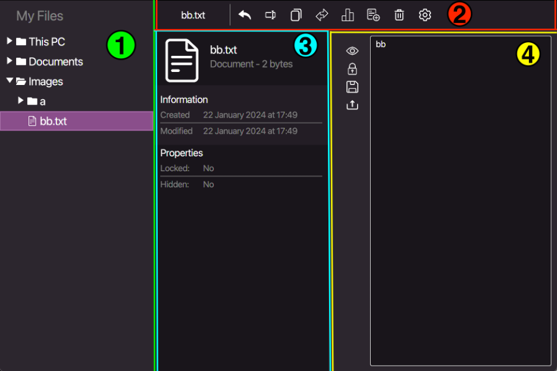
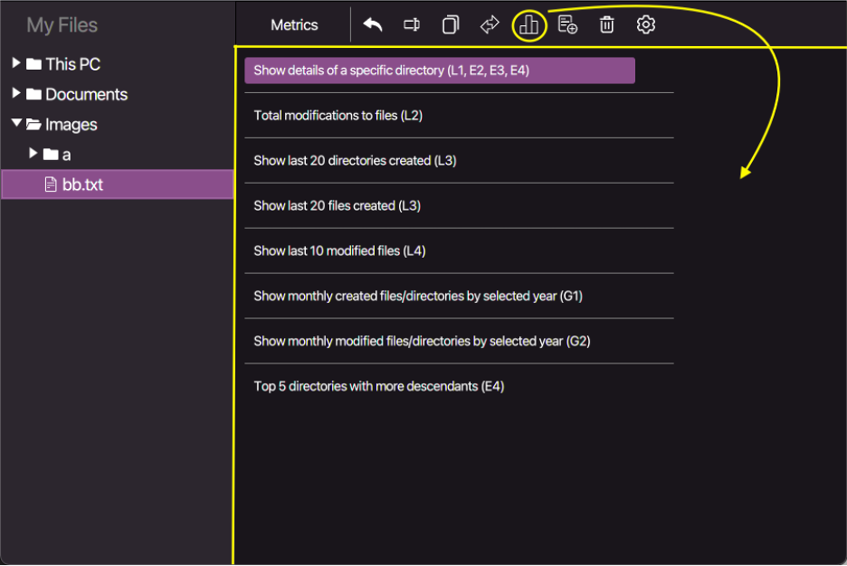
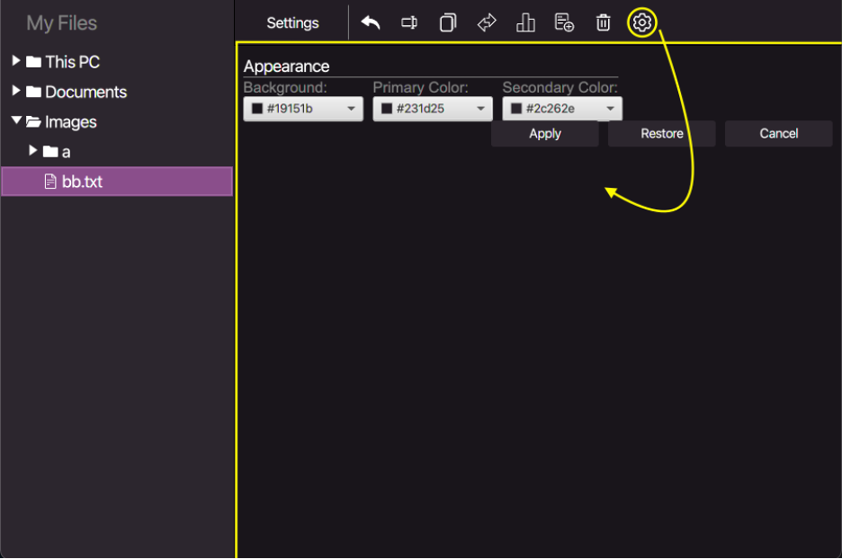
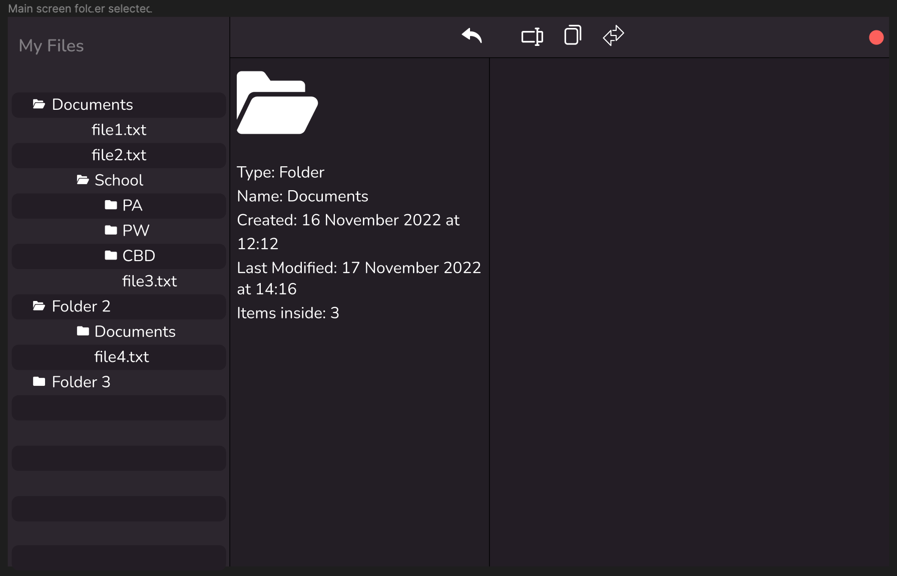
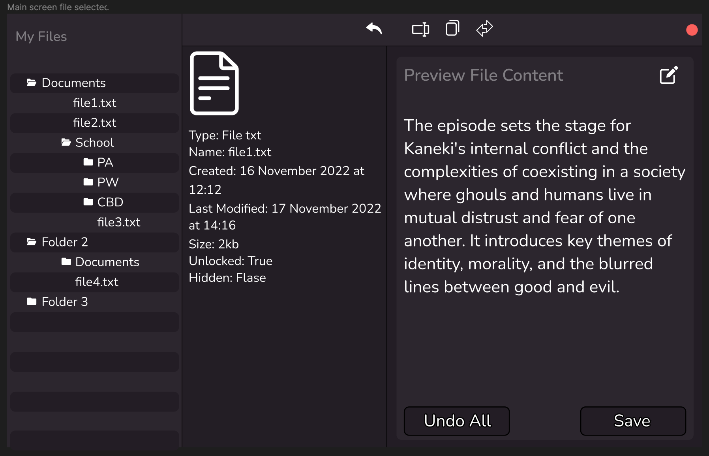
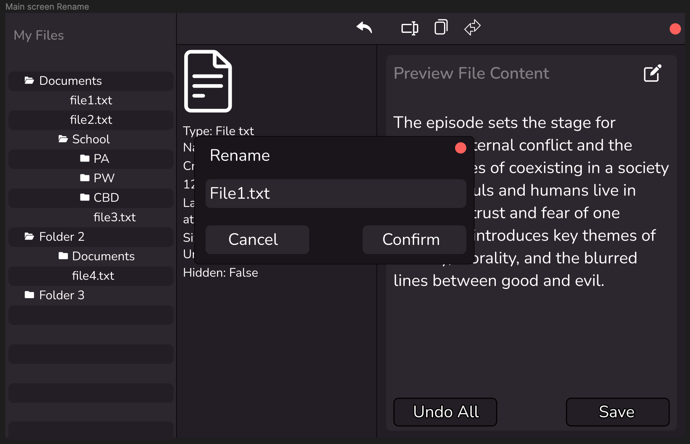
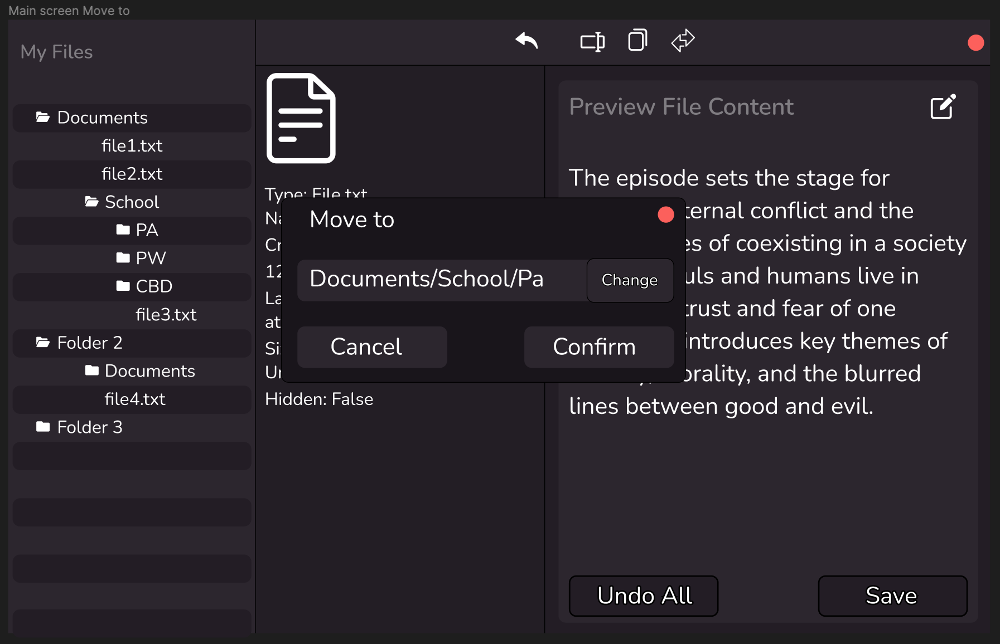
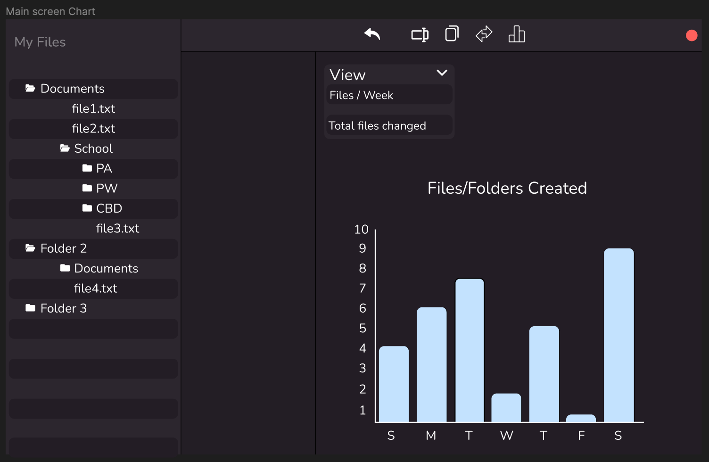

# README

---

#  Personal File System (PFS)
Este programa consiste em uma aplicação gráfica que simula a gestão de um sistema de
arquivos chamado
Personal File System (PFS).
Este sistema oferecerá suporte a operações
básicas sobre arquivos e diretórios, como criação, edição, cópia, exclusão e navegação
entre eles.

---

# 1. Apresentação da aplicação

## Principais Funcionalidades

O programa contém algumas funcionalidades podendo separá-las em categorias. Com relação aos ficheiros e diretorias podemos:
•	Criar, Remover,
Renomear, Copiar ou mover ficheiros/diretorias.
Cada uma destas ações pode ser desfeita utilizando a funcionalidade undo.

Com relação apenas aos ficheiros podemos:
•	Tornar o seu conteúdo visível,
•	Modificar o codeúdo de um ficheiro,
•	Impedir que este seja modificado,
•	Exportar um ficheiro.

Ainda podemos consultar gráficos e listas que dispõem informações sobre o nosso Personal File System, tal como o número de ficheiros criados num mês/ano, as últimas 10 diretorias criadas, os últimos 10 ficheiros modificados etc...

Por fim é possível alterar as cores da interface da nossa aplicação.

## Modo de utilização
A utilização deste programa é bastante simples.
A página principal da nossa aplicação, pode ser subdividida em 4 zonas, demarcadas na imagem seguinte.

A zona 1* permite verificar quais são os ficheiros e diretorias presentes no nosso Personal File System. É aqui que vamos selecionar um ficheiro para ver/modificar a sua informação.

A zona número 2* corresponde a uma Toolbar, que nos apresenta o nome do ficheiro ou diretória que está selecionada e mais 8 botões sendo eles: undo, rename, copy, move, metrics, create, remove e settings.
A zona número 3* indica a informação do elemento selecionado, aqui é possível ver o nome, o tamanho do elemento, data de criação, a data da última modificação, se está visível e se é possível editá-lo.

Finalmente a última zona (4*), demonstra um painel que apenas é exibido assim que um ficheiro é selecionado. Neste painel temos disponíveis 4 botões, o botão view que permite esconder o conteúdo do ficheiro, o botão lock impedindo que este seja editado na caixa de texto, um botão save para guardar as alterações feitas no conteúdo do ficheiro e um botão export para exportá-lo para o computador.

Ao carregar no botão das métricas, é nos apresentado, no lugar das zonas 3 e 4, um painel com várias opções, como é possível ver na imagem seguinte.

Cada uma destas opções, apresenta informação correspondente aos ficheiros e diretórios contidos no Personal File System, sobre a forma de listas, gráficos etc.…

Ao carregar no botão settings é nos apresentado outro painel, novamente na zona 3 e 4.

Aqui é possível mudar as cores da nossa aplicação, basta carregar em uma das 3 opções disponíveis e escolher uma cor ao nosso gosto. Após isso carregamos no botão “Apply” para confirmar a mudança, podemos também carregar no botão “Restore” para voltar às cores originais do programa ou “Cancel” para interromper qualquer mudança em procedimento.

---
# 2. Implementação da aplicação

## Arquitetura Lógica da Aplicação

### Classes:

Logger – A classe Logger fornece um mecanismo simples de registo para gravar mensagens num ficheiro.
Suportando diferentes níveis de registo com base no nível especificado. Essencialmente esta classe guarda as ações realizadas no Personal File System, em ficheiros de texto.

---

### - View
ColorSettings – Classe responsável por fazer o gerenciamento das cores da aplicação.

CustomTreeCell – Classe responsável por criar um estilo para a TreeView.

MetricsView – Classe responsável pela interface das métricas, esta classe faz também o gerenciamento dos gráficos.

PersonalFileSystemView – Classe responsável pela interface gráfica da aplicação, oferecendo funcionalidades como a
TreeView do PFS, uma ToolBar com várias ações e configurações para personalização da aparência, etc...

SettingsView – Classe responsável pela interface gráfica das settings.

---

### - Observer
Subject – Classe que representa um objeto que pode ser “Observado” por outros objetos. Contem uma lista de Observers
juntamente com métodos para modificá-la. Por fim contem o método notifyObservers() que executa o método update() de cada Observer da sua lista.
Foi essencial para a aplicação do padrão Observer.

---

### - Model
Directory – Classe que representa uma diretoria.

File – Classe que representa um ficheiro.

FileSystemItem – Esta classe representa um elemento do FileSystem, podendo este ser um ficheiro ou uma diretoria.

PersonalFileSystem– Esta classe representa um sistema de arquivos pessoal com organização hierárquica.
Ela oferece métodos para manipular o sistema de arquivos, incluindo a adição, remoção, movimentação, cópia, renomeação e edição de elementos.
Além disso, a PersonalFileSystem permite a observação de alterações no sistema de arquivos por meio de observers.

TreeLinked – Esta classe representa uma TreeLinked, é num objeto deste tipo,
onde vão ser guardados os nossos ficheiros. É também sobre este objeto onde vão ser aplicadas as operações de ficheiros e diretorias.

---

###	- Controller
PersonalFileSystemController – Esta é a classe que contem métodos para executar as operações tais como doAddFileOrDirectory() e doRemoveFileOrDirectory(). A classe atua como o controlador no padrão MVC. Gerencia as interações do usuário, atualiza o Model e interage com a View.

---

### - Command
ActionManager – Esta classe é responsável por receber e executar os comandos assim como que guardar numa stack os últimos comandos executados, permitindo realizar o método unexecute() desfazendo o ultimo comando. Através deste método, surge então a operação undo

As seguintes Classes representam os comandos concretos, estas implementam a interface Command dando Override aos seus métodos execute() e unexecute().

AddCommand – Classe que representa o comando concreto para adicionar ficheiros/diretorias,  
CopyCommand – Classe que representa o comando concreto para copiar ficheiros/diretorias,  
MoveCommand – Classe que representa o comando concreto para mover ficheiros/diretorias,  
RemoveCommand – Classe que representa o comando concreto para remover ficheiros/diretorias,  
RenameCommand – Classe que representa o comando concreto para renomear ficheiros/diretorias.

---
## Padrões de software
Model View Controller (MVC) – Este padrão permitiu uma organização clara realizando a separação das responsabilidades no código.
Fazendo a View cuidar da apresentação e interação com o utilizador, enquanto o Controller cuida das operações sobre os ficheiros e diretorias que estão presentes no Model,
foi possível facilitar a manutenção do código para alem de o tornar mais compreensível.

Observer – Este padrão permitiu que a nossa View fosse atualizada em simultâneo com o Model. Uma das aplicações foi na nossa classe
PersonalFileSystem que sendo uma Subject, contem Observers um dos exemplos é a PersonalFileSystemView, que atualiza a sua interface quando existe uma atualização na PersonalFileSystem.

Command – Este padrão permitiu separar os comandos das operações, encapsulando os mesmos e tornando mais fácil o seu gerenciamento.
Vale ressaltar que pela aplicação deste padrão foi possível implementar também o comando undo, que corre o método unexecute() do ActionManager correspondente a cada comando dentro
de uma Stack com os últimos comandos executados.

---

# Mockup

---

## Authors
António Monteiro - 202100316,  
Ivandro Antunes - 201801045,  
Joana Silva - 202100190,  
José Lúcio - 202100198.

